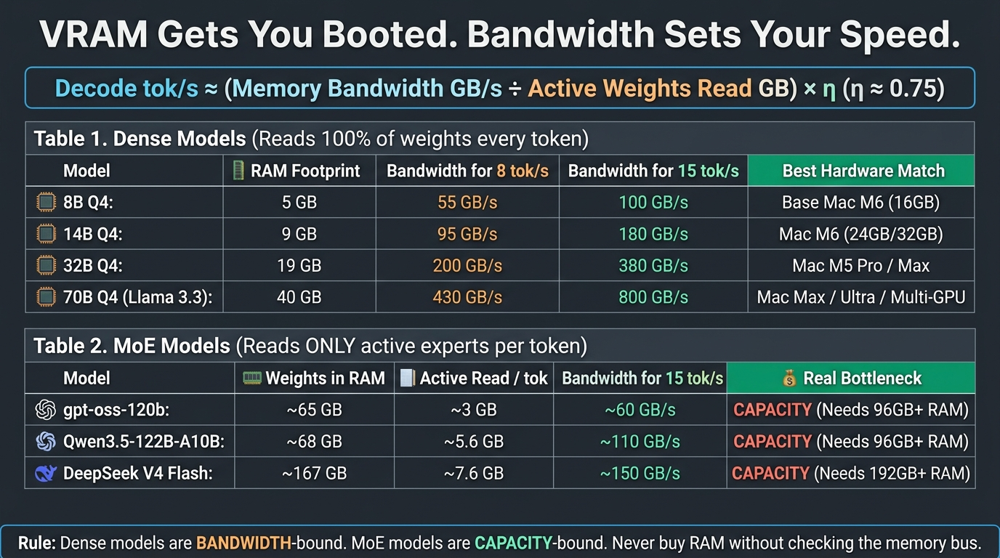

# You are buying VRAM, but you should be looking at memory bandwidth too

Apple released the Mac mini with the new M6 chip in August 2026, in 16 GB, 24 GB and 32 GB variants (the M5 Pro mini
goes up to 64 GB). If you are deciding which one to buy for local models, the spec sheet naturally pushes you toward one
question: how much memory?

Here is the buying perspective. Capacity is sold in steps (16, 24, 32 GB) with a price jump at each. But bandwidth,
which sets speed, barely moves. Per [Apple's tech specs](https://support.apple.com/en-us/128108), the 16 GB model runs
at 153.6 GB/s (LPDDR5X-9600) and the 24 GB and 32 GB models at 170 GB/s (LPDDR5X-10667). So going from 16 to 24 GB
buys capacity *and* about 10% more bandwidth. Going from 24 to 32 GB buys capacity only, and no model gets faster. It
just lets you load a bigger one, which then runs slower on the same bus. About 170 GB/s is a good, useful level for
models up to the low-30B range. Paying for much more capacity without more bandwidth gets you models you can load but
will not enjoy using. For comparison, the M5 Pro mini has 307 GB/s.

When people size a machine for local LLMs, the first question is almost always "how much VRAM, or unified memory, do I
need?" It is a fair question, but it only answers half of the problem.

- **Capacity** decides what you can *load*.
- **Bandwidth** decides what you can *tolerate using*.

(Processor speed matters too, mostly for reading the prompt. For generating text, bandwidth is the bottleneck.)

## Why bandwidth sets the speed

For single-user text generation (batch size 1), the chip must read every weight of the model from memory to produce
**one token**. A 20 GB model means 20 GB of reads per token. So the ceiling is:

```
decode tokens/sec  ≈  memory bandwidth (GB/s)  ÷  model size in memory (GB)  ×  η
```

η is how efficiently the engine uses the memory bus. In practice it is roughly 0.70-0.85 with engines like MLX and
llama.cpp. Use 0.75 if you want one number.

### Decode vs Prefill: Why Time To First Token (TTFT) Matters

LLM inference has two distinct phases, governed by completely different physical bottlenecks:

1. **Decode (Token Generation):** Outputting tokens one by one. This is strictly **memory-bandwidth bound**.
2. **Prefill (Prompt Processing / TTFT):** Ingestion of the user prompt, RAG context, and system instructions into the KV cache. This is **compute-bound (FLOPs)**, parallelized across matrix compute units.

If you only look at decode bandwidth, you miss half the user experience. A model might generate at a comfortable 14 tok/s, but if it takes 30 seconds just to read your 16k-token prompt before outputting the first word, the experience feels broken.

This is where the **Mac mini M6** shines. With its 12-core GPU featuring integrated Neural Accelerators and dual 16-core Neural Engines, the M6 has exceptional matrix compute density relative to its size:
- **14B Model (e.g. Qwen 2.5 14B Q4):** Prefill runs at **~900 tokens/sec**.
  - A short prompt (1,000 tokens): TTFT is **~1.1 seconds**. First token appears almost instantly.
  - A dense RAG document (16,000 tokens): TTFT is **~17.7 seconds**.
- **32B Model (e.g. Qwen 2.5 32B Q4):** Prefill runs at **~400 tokens/sec**.
  - A short prompt (1,000 tokens): TTFT is **~2.5 seconds**.
  - A dense document (16,000 tokens): TTFT is **~40 seconds**.

Combined with decode, this determines your total perceived waiting time:
- **14B short task (1k prompt / 500 generation):** 1.1s prefill + 35s decode = **~36 seconds total**.
- **14B long task (16k prompt / 500 generation):** 17.7s prefill + 35s decode = **~53 seconds total**.
- **32B short task (1k prompt / 500 generation):** 2.5s prefill + 71s decode = **~74 seconds total**.
- **32B long task (16k prompt / 500 generation):** 40s prefill + 71s decode = **~111 seconds (~1.8 minutes)**.

For interactive agent loops and continuous tool-calling where prompts are repeatedly digested, fast prefill is just as critical as raw generation bandwidth.

## The paperweight trap

Say you have 64 GB of memory on a base-tier chip with about 170 GB/s of bandwidth, or 128 GB of cheap dual-channel DDR5
at about 70 GB/s.

| Model | Size (Q4) | Bandwidth | Estimated decode |
|---|---|---|---|
| 14B | ~9 GB | 170 GB/s | ~14 tok/s |
| 32B | ~19 GB | 170 GB/s | ~7 tok/s |
| 70B | ~40 GB | 170 GB/s | ~3 tok/s |
| 70B | ~40 GB | 70 GB/s (DDR5) | ~1.3 tok/s |

The 70B model *loads*. But 3 tok/s means about two minutes for a 400-word answer, and 1.3 tok/s is unusable for
anything interactive. The extra RAM bought you a model you cannot comfortably run.

## What speed is usable?

| tok/s | Feels like | Good for |
|---|---|---|
| 18+ | Interactive, faster than you can skim | Chat, inline coding, fast iteration |
| 7-12 | Reading speed | Agents, reasoning, long-form work |
| under 4 | Painful | Overnight and batch jobs only |

## Sizing table

Required bandwidth is the formula turned around: `bandwidth ≈ target tok/s × model size ÷ η`, with η = 0.75 and Q4
weights.



| Model tier | Q4 size | VRAM to run it (with context) | Bandwidth for 15 tok/s | Bandwidth for 8 tok/s | Hardware class |
|---|---|---|---|---|---|
| 7-9B | 5-6 GB | 8-12 GB | ~100-120 GB/s | ~55-65 GB/s | Base Apple Silicon, RTX 4060 |
| 14B | ~9 GB | 12-16 GB | ~180 GB/s | ~95 GB/s | Base Mac for chat, Pro chip for comfort |
| 32B | ~19 GB | 24-32 GB | ~380 GB/s | ~200 GB/s | Max-class chip, RTX 3090/4090 |
| 70B | ~40 GB | 48-64 GB | ~800 GB/s | ~430 GB/s | Max/Ultra, multi-GPU |

## Bigger models: 70B, ~120B and DeepSeek V4 Flash

The formula uses the **bytes read per token**, and for a mixture-of-experts (MoE) model that is the *active*
parameters, not the total. A dense 70B model reads all 70B weights for every token. An MoE model keeps all its experts
in memory but reads only a few of them per token. So for MoE:

- **Memory capacity** is set by *total* parameters.
- **Bandwidth needed** is set by *active* parameters.

```
bandwidth needed (GB/s)  ≈  target tok/s  ×  active weights read per token (GB)  ÷  η
```

With η = 0.75. "Active GB" is active parameters × bytes per parameter for that quantization, so it is my estimate.

| Model | Type | Total / active params | Weights in memory | Active GB/token | Bandwidth for 8 tok/s | Bandwidth for 15 tok/s |
|---|---|---|---|---|---|---|
| Llama 3.3 70B (Q4) | Dense | 70B / 70B | ~40 GB | ~40 GB | ~430 GB/s | ~800 GB/s |
| gpt-oss-120b (MXFP4) | MoE | 117B / 5.1B | ~65 GB | ~3 GB | ~32 GB/s | ~60 GB/s |
| Qwen3.5-122B-A10B (Q4) | MoE | 122B / 10B | ~68 GB (est.) | ~5.6 GB | ~60 GB/s | ~110 GB/s |
| DeepSeek V4 Flash (FP4+FP8) | MoE | 284B / 13B | ~167 GB (81 GB with aggressive quants) | ~7.6 GB | ~80 GB/s | ~150 GB/s |

What this means on real chips (decode ceiling at η = 0.75, ignoring attention and KV-cache reads):

| Chip | Bandwidth | Max memory | Llama 3.3 70B Q4 | gpt-oss-120b | DeepSeek V4 Flash |
|---|---|---|---|---|---|
| Mac mini M6 | 170 GB/s | 32 GB | ~3 tok/s, does not fit | ~40 tok/s, does not fit | ~17 tok/s, does not fit |
| Mac mini M5 Pro | 307 GB/s | 64 GB | ~6 tok/s, tight fit | ~75 tok/s, does not fit (65 GB weights) | ~30 tok/s, does not fit |
| M5 Max | 460-614 GB/s | 128 GB | ~9-12 tok/s | ~115+ tok/s, fits | ~45-60 tok/s, only with ~80-100 GB quants |

The lesson flips for MoE models. For a **dense 70B**, bandwidth is the wall: you need 430 GB/s for reading speed and
800 GB/s to feel interactive, so only Max/Ultra-class chips are comfortable. For **gpt-oss-120b and DeepSeek V4 Flash**,
bandwidth is modest (60-150 GB/s would do), and the wall is *capacity*: 65 GB and 167 GB of weights. A 32 GB Mac mini
has the bandwidth but not the memory. Offloading experts to SSD is far slower than RAM, so it does not rescue it.

Two caveats. Prefill touches nearly all experts, so long prompts on huge MoE models are slower than the decode figures
suggest. And a newer DeepSeek-V4.1-Flash (about 552B backbone plus 196B Engram parameters, 8B active per token while
reading the prompt and 16B while writing) has even larger weights, so it makes the capacity point stronger.

## Applying it: a capacity map for the 16, 24 and 32 GB Mac mini M6

Bandwidth: 153.6 GB/s for 16 GB and 170 GB/s for 24 and 32 GB, with η = 0.75. macOS keeps roughly 3-4 GB, so usable
memory is about 12, 18 and 24 GB. Speeds are estimates from the formula, not measurements.

| Variant | Bandwidth | Usable | Models that fit well | Est. decode | Verdict |
|---|---|---|---|---|---|
| 16 GB | 153.6 GB/s | ~12 GB | 7-9B at Q4 (~5 GB) or Q8 (~8.5 GB); 14B Q4 with short context only | 8B Q4 ~23 tok/s; 8B Q8 ~13; 14B Q4 ~13 | Fast chat and light coding. Hits the ceiling at 14B. |
| 24 GB | 170 GB/s | ~18 GB | 14B at Q4, ~32k context; 8-9B at Q8 with long context | 14B Q4 ~14 tok/s | The sweet spot for interactive use. Cannot load a 32B model. |
| 32 GB | 170 GB/s | ~24 GB | 14B with 64-128k context; 32B Q4 with 8-16k context | 14B ~14; 32B ~7 | Unlocks 32B, but at reading speed. Good for "assign it a task and wait". |

How I read this as a buyer:

- **16 GB** is enough if you live in 7-9B models. Speed is within about 10% of the bigger variants.
- **24 GB** is the interactive sweet spot. 14B runs at ~14 tok/s with real context.
- **32 GB** buys you a *capability* step (32B has better multi-step logic, coding and instruction following than 14B).
  It does **not** buy speed. At 170 GB/s, 32B is about 7 tok/s, so it is an async-agent machine, not a chat machine.
  Buy it only if you want that.
- **Beyond 32 GB at this bandwidth** adds little. A 70B model would load but run at ~3 tok/s. For 70B you need
  Max-class bandwidth (the M5 Max is 460-614 GB/s), not more RAM on the same chip.

That is why about 170 GB/s is a useful level: it comfortably serves everything up to 14B, and 32B at a patient pace.
More RAM on the same bandwidth is not that useful.

## Takeaways

1. Compute `bandwidth ÷ model size × 0.75` **before** you buy.
2. Capacity without matching bandwidth gives diminishing returns for interactive use.
3. Past about 32B, bandwidth (Max/Ultra-class) matters as much as the gigabyte number.
4. Prompt-heavy work (RAG, long documents) also depends on prefill, so processor speed still counts.

## Sources

- [Mac mini (M6 or M5 Pro) tech specs, Apple](https://support.apple.com/en-us/128108): 16 GB, configurable to 24 or 32 GB (170 GB/s)
- [Apple newsroom: Mac mini with M6 and M5 Pro](https://www.apple.com/newsroom/2026/08/apple-unveils-a-more-powerful-mac-mini-featuring-the-all-new-m6-and-m5-pro/)
- [Mac mini M6 memory bandwidth: 16 vs 24 vs 32 GB, Zeera Wireless](https://zeerawireless.com/blogs/news/mac-mini-m6-16gb-vs-24gb-vs-32gb): 153 GB/s for 16 GB
- [CNET first look at the M6 Mac mini](https://www.cnet.com/tech/computing/m6-mac-mini-first-look-bigger-power-packed-in-same-small-package/): 153 and 170 GB/s, M5 Pro 307 GB/s
- [DeepSeek-V4-Flash on Hugging Face](https://huggingface.co/deepseek-ai/DeepSeek-V4-Flash): 284B total, 13B active, FP4+FP8 mixed
- [DeepSeek V4 Flash hardware requirements, Yotta Labs](https://www.yottalabs.ai/post/deepseek-v4-flash-hardware-requirements-gpu-memory-2026): ~167 GB of weights
- [gpt-oss-120b on Hugging Face](https://huggingface.co/openai/gpt-oss-120b): 117B total, 5.1B active, MXFP4
- [gpt-oss-120b hardware requirements, Llama Builds](https://www.llamabuilds.ai/models/gpt-oss-120b): ~65 GB weights
- [Apple M5, Wikipedia](https://en.wikipedia.org/wiki/Apple_M5): M5 Pro 307 GB/s, M5 Max 460/614 GB/s
